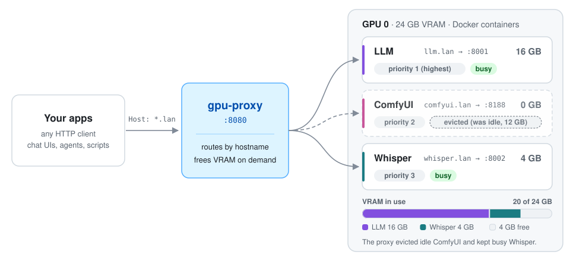

# gpu-proxy

gpu-proxy lets you run more AI models on one NVIDIA GPU than fit in its VRAM at once. It's a reverse proxy that sits in front of your model servers, each running in its own Docker container. You give each one a priority. When a request needs more VRAM than is free, the proxy makes room by stopping or restarting idle or less important containers.

Your model servers don't need any changes. You just point your apps at the proxy instead of at each server, and everything passes through, including streaming and WebSockets.

<p align="center">
  <picture>
    <source media="(prefers-color-scheme: dark)" srcset="guide/images/architecture-dark.svg">
    
  </picture>
</p>

## Why it exists

Say you run an LLM, a speech-to-text model, an image generator and a few small embedding models on one workstation. Each one fits in VRAM on its own. Run them all at once, and you get CUDA out-of-memory errors.

Each model also runs in its own server, like vLLM, llama.cpp, ComfyUI or a Whisper server. None of those servers can see how much VRAM the others are using.

All of these servers have an HTTP API, so gpu-proxy can sit in front of them and decide which models stay in VRAM as requests arrive. One 96 GB card can serve [12 GPU services](https://blog.zijiangyang.com/posts/twelve-ai-models-one-gpu/) this way, even though loading them all at once would take about 312 GB.

## When you don't need it

You probably don't need gpu-proxy if:

- You run all your models through one server like Ollama. It already loads and unloads models for you.
- You switch many times a minute between models that don't fit in VRAM together. Each switch reloads a model, and that takes seconds to minutes.
- You want to spread work across several GPUs or machines. Look at Kubernetes or Ray instead.

## How it works

1. When a request arrives for a hostname like `llm.lan`, the proxy matches the request to the service with that hostname.
2. For each service, you list the URL path prefixes that use the GPU, like `/v1/chat/completions`. Requests to other paths go straight through. When a request matches a GPU path, the proxy checks whether enough VRAM is free.
3. If there isn't enough VRAM, the request waits while the proxy evicts other containers. It evicts idle containers first, starting with the least important. It only evicts a busy container when a more important service needs room. Before evicting a busy container, the proxy gives it time to finish its current requests. Once there's room, the proxy sends the request on.
4. If the proxy can't free enough VRAM in time, it sends the request to the service's backup server, such as one running the same model on the CPU. Without a backup, the proxy returns a 503 error.

## Requirements

- Linux with an NVIDIA GPU. The proxy only manages GPU 0.
- Docker, with each model server in its own container
- Python 3.12 or newer
- Node.js and npm, to build the dashboard
- Root access, so the proxy can see how much VRAM each container uses

## Quick start

### 1. Install

Clone this repository and run these commands in its folder:

```bash
python3 -m venv venv
venv/bin/pip install -r requirements.txt
cd dashboard && npm install && npm run build && cd ..
```

### 2. Prepare your containers

#### Servers that load their model on the first request

Start these as usual with `docker run`. ComfyUI is one of them.

#### Servers that load their model at startup

vLLM, SGLang and llama.cpp load their model as soon as they start, so they may not all fit in VRAM at once. Create these containers with `docker create` instead, so they stay stopped. In step 3, you'll set up the proxy to start each container when a request arrives for it.

Also give them a Docker health check, so the proxy waits until the model has loaded before it sends the request. For llama.cpp listening on port 8080 inside the container, add this to `docker create`:

```bash
--health-cmd "curl -sf http://localhost:8080/health"
```

### 3. Describe your services

Create `config.yaml` in the project folder. In this example, an LLM and ComfyUI share a 24 GB card, but they don't both fit at once:

```yaml
listen_port: 8080
total_vram_budget: 22000          # The most VRAM all services can use together, in MiB. Set this a bit under the GPU's total.
dashboard_hostname: gpu-proxy.lan

plugins:
  - name: lazy_start
    type: LazyStartContainer

services:
  llm:
    priority: 1                   # 1 is the most important. Each service needs its own number.
    vram_budget: 16000            # Peak VRAM you expect this service to need, in MiB. Start with a guess.
    hostname: llm.lan             # Requests for this hostname go to this service.
    target: http://127.0.0.1:8001 # The URL of the model server.
    container: llama-server       # The name of its Docker container.
    gpu_routes:                   # URL path prefixes that use the GPU.
      - /v1/chat/completions
      - /v1/completions
      - /v1/responses
    eviction_command: "docker stop {container}"
    plugins: [lazy_start]         # Starts the stopped container when a request arrives.

  image-gen:
    priority: 2
    vram_budget: 12000
    hostname: comfyui.lan
    target: http://127.0.0.1:8188
    container: comfyui
    gpu_routes:
      - /prompt
```

The proxy evicts `image-gen` with the default `docker restart`, which leaves ComfyUI empty until its next request. A restart would load `llm`'s model straight back, so `llm` is evicted with `docker stop` instead, and the [`LazyStartContainer`](guide/plugins.md#lazystartcontainer) plugin starts it again when a request arrives.

### 4. Run it

```bash
sudo venv/bin/python3 -m app.main     # reads ./config.yaml
```

The proxy listens on all network interfaces and has no authentication. Only run it on a network you trust.

### 5. Connect to the proxy

#### Point hostnames at the GPU machine

Every hostname in `config.yaml` must point to the GPU machine. To test on the GPU machine itself, add this line to `/etc/hosts`:

```
127.0.0.1  llm.lan comfyui.lan gpu-proxy.lan
```

For other machines, map those hostnames to the GPU machine's IP address in your local DNS or in each machine's hosts file.

#### Send a test request

```bash
curl http://llm.lan:8080/v1/chat/completions \
  -H "Content-Type: application/json" \
  -d '{"model": "your-model", "messages": [{"role": "user", "content": "Hello"}]}'
```

#### Point your apps at the proxy

In OpenAI-compatible apps, set the base URL to `http://llm.lan:8080/v1`. Point other apps at their service's hostname on the proxy's port, like `http://comfyui.lan:8080`.

### 6. Open the dashboard

Open `http://gpu-proxy.lan:8080` in your browser to watch your services. Once you see how much VRAM each service really uses, update its `vram_budget` in `config.yaml` to match.

### 7. Start it on boot

Stop the proxy from step 4 if it's still running. The included `gpu-proxy.service` file expects the project in `/var/gpu_proxy`, so edit the paths in that file if you cloned the repository somewhere else. Under systemd, the proxy writes its logs to `/var/log/gpu-proxy.log`.

```bash
sudo cp gpu-proxy.service /etc/systemd/system/
sudo systemctl daemon-reload
sudo systemctl enable --now gpu-proxy
```

## Learn more

- The [configuration reference](guide/configuration.md) explains every setting, including backups, health checks, priorities and services on other machines.
- The [plugins page](guide/plugins.md) explains `LazyStartContainer` and the plugins for OpenAI-compatible servers. The OpenAI plugins can catch bad replies, trim old context, set request fields and show token speed.

## License

[MIT](LICENSE)
